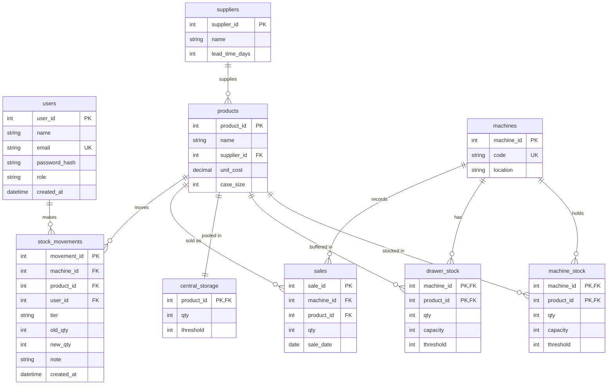

# SmartStock: Adlers Vending Machine Operations

BFB 321, Group 25. Claudia Aird (u21433098) and Josua Olivier (u23524431).

SmartStock is a web dashboard that gives Mr Msiza **one system** for the three places his vending stock lives:
the **machine**, the small **drawer** at its base, and the shared **central storage** at the Adlers café.
It also turns what is needed into **one consolidated order per supplier**.
It replaces the paper log and goes beyond what the third-party app Moma tracks.

> **Demo data.** Every machine, product, sale and stock level in this repo is synthetic.
> The Moma sensor feed named in the proposal is not available, so machine stock is entered as a
> manual count (the fallback stated in the proposal).

## Features (mapped to the proposal)

| Feature | Page | Objective |
|---|---|---|
| Machine, drawer and central stock side by side | Machines, then a machine | O1, O2 |
| Record a manual machine count | Machine page | O1 (fallback) |
| Log a restock visit (fills machine, then drawer, then returns the rest to central) | Machine page | O2 |
| Central storage tracker | Central storage | O2 |
| Drawer allocation ranking from 30-day sales | Allocation | O3 |
| Consolidated shopping list, one order per supplier | Shopping list | O4 |
| Low-stock alerts across all three tiers | Alerts | O3, O5 |
| KPI dashboard (alerts, central value, trips saved, best sellers, impact estimate) | Dashboard | O5 |

## Quick start (Windows PowerShell)

```
git clone https://github.com/u21433098/u21433098-group25_smartstock_dashboard.git
cd u21433098-group25_smartstock_dashboard
python -m venv venv
venv\Scripts\activate
pip install -r requirements.txt
python run.py
```

Open http://127.0.0.1:5000 in a browser. The page styles load Bootstrap's CSS from a CDN, so an internet connection is needed.

**Demo login:** `msiza@adlers.test` / `SmartStock123`

If activation says "running scripts is disabled", run once:
`Set-ExecutionPolicy -Scope CurrentUser -ExecutionPolicy RemoteSigned`

Optional: copy `.env.example` to `.env` and set your own `SECRET_KEY`.

## Run the tests

```
pytest
```

- `tests/test_safety_stock.py`, `test_allocation.py`, `test_procurement.py`: unit tests for the supply chain model, checked against hand-calculated answers.
- `tests/test_routes.py`: integration tests for login, access control, CSRF protection, and the stock-changing flows.

## Project structure

```
app/
  __init__.py         create_app(): settings, login, CSRF, error pages
  blueprints/         one file per feature: auth, dashboard, inventory, allocation, procurement
  services/           the ONLY layer that touches data (swap for MySQL later) and calls the models
  data/seed_data.py   synthetic demo data (in memory)
  templates/          one HTML file per page + base.html and _macros.html
  static/css/         style.css (on top of Bootstrap CSS)
  models/             (reserved) database table classes for the MySQL version
  schemas/            (reserved) request/response schemas for the REST API version
models/               supply chain model: pure Python, no Flask, no database
  safety_stock.py     average demand, std deviation, safety stock, reorder point
  allocation.py       turnover ranking, greedy drawer allocation, restock split
  procurement.py      order-up-to level, order quantity, supplier grouping, trips saved, EOQ
tests/                pytest unit and integration tests
config.py             DEV / TEST / PROD settings
run.py                entry point
```

## Supply chain model

All formulas are in `models/` with docstrings stating assumptions.

| Quantity | Formula |
|---|---|
| Safety stock | `SS = z x s x sqrt(L)` (z = 1.645, a 95% service level) |
| Reorder point | `ROP = d x L + SS` |
| Order-up-to level (weekly review) | `S = d x (L + R) + z x s x sqrt(L + R)` |
| Order quantity | `(S - stock on hand)`, rounded **up** to whole cases |
| Trips saved | `products to order - suppliers to visit` |
| Economic order quantity | `EOQ = sqrt(2DS / H)` |

d = average daily demand, s = standard deviation of daily demand, L = supplier lead time (days), R = review period (7 days, the weekly supplier run).
"Stock on hand" adds the machine, drawer and central tiers together.

**Drawer allocation (O3):** rank products by units sold in the last 30 days; give each its desired buffer
(3 days of sales, capped by its slot size), fastest sellers first, until the drawer's total space (50 units) is used.
Anything that does not fit stays in central storage.

**Impact estimate.** Two 60-minute unplanned supplier trips a week is about 8.7 hours of driving a month.
A 25% cut in trips (O4) therefore saves about **2.2 hours a month**. This is a modelled estimate, not a measurement.
(This replaces the earlier "5-6 hours a month" estimate, which overstated the saving.)

## Design decisions

- **No JavaScript.** Every action is an HTML form submit and every page is a server-rendered Jinja template.
  Bootstrap is used for its CSS only. The navigation bar wraps on small screens instead of using a menu button.
- **One template per page**, with shared pieces (navigation bar, flash messages, KPI cards, stock badges) in `base.html` and `_macros.html`.
- **Passwords are hashed**, forms are protected by a CSRF token, and login redirects only to pages inside this site.
- **Services layer.** Routes never touch the data directly, so moving to MySQL means rewriting `app/services` and leaving the templates alone.

## Planned MySQL data model (next stage)



In this lean version the tables are Python dictionaries in `app/data/seed_data.py`, and each `(machine, product)` pair keeps a list of 30 daily sales numbers instead of dated `sales` rows.

## Known limitations

- Data lives in memory and **resets when the server restarts** (MySQL is the next stage).
- No live sensor feed: machine stock is a manual count.
- No pagination or column sorting yet (both need extra work for the final stage).
- Runs on Flask's development server; no production deployment was done for the semester project.

## Task allocation

| Member | Student no. | Files owned | Reviewed by |
|---|---|---|---|
| Claudia Aird | u21433098 | Supply chain model (`models/`) and its unit tests (`tests/test_safety_stock.py`, `test_allocation.py`, `test_procurement.py`), demo data (`app/data/seed_data.py`), services layer (`app/services/`), `config.py`, `run.py`, `.env.example`, `README.md` | Josua Olivier |
| Josua Olivier | u23524431 | Frontend: page templates (`app/templates/`) and stylesheet (`app/static/css/style.css`); routes (`app/blueprints/`), app factory (`app/__init__.py`), integration tests (`tests/test_routes.py`) | Claudia Aird |
