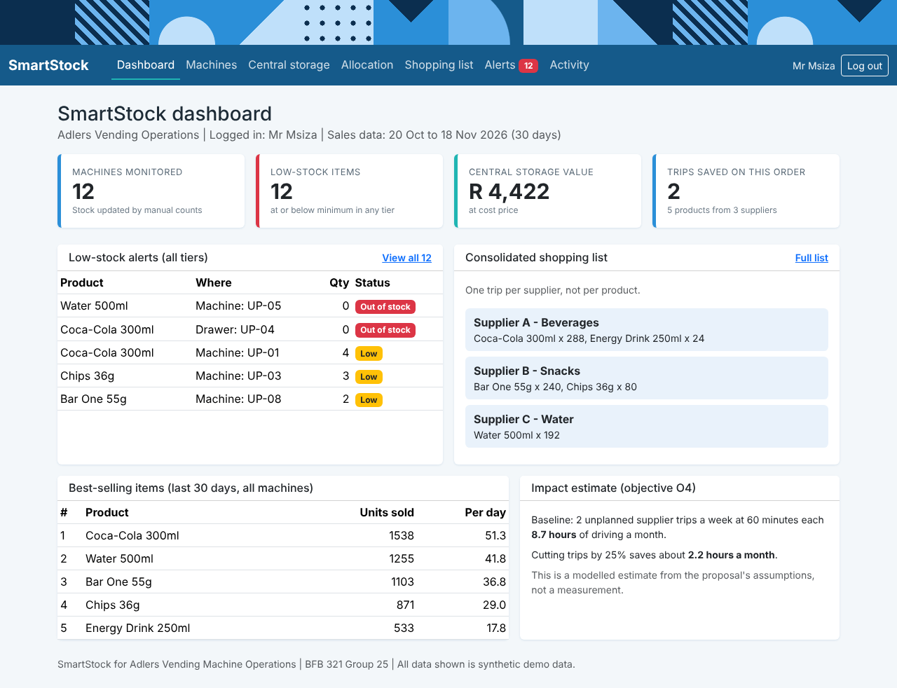
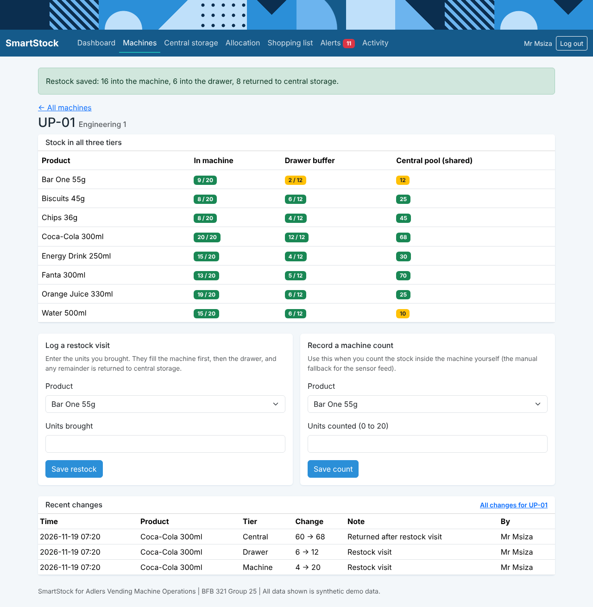
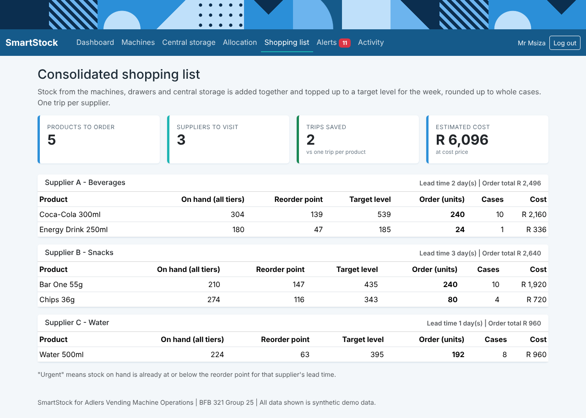
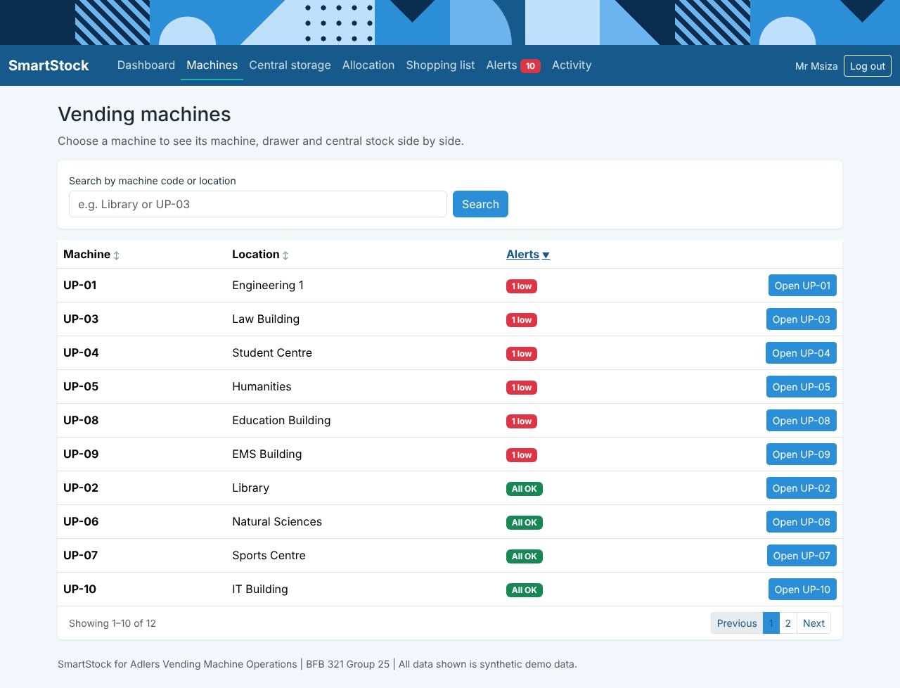
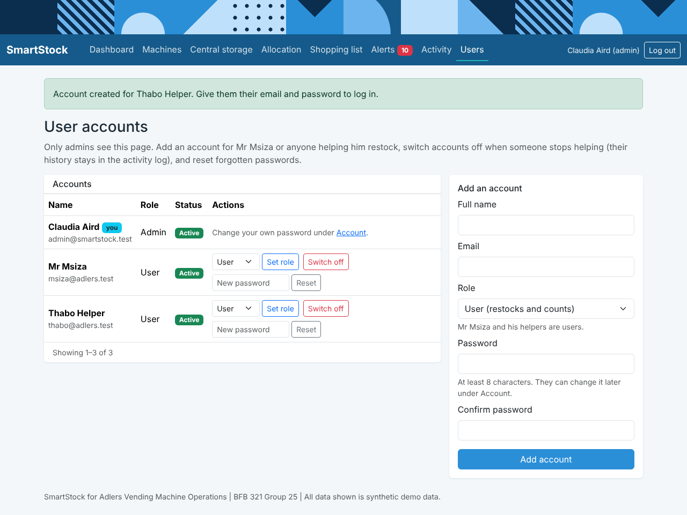
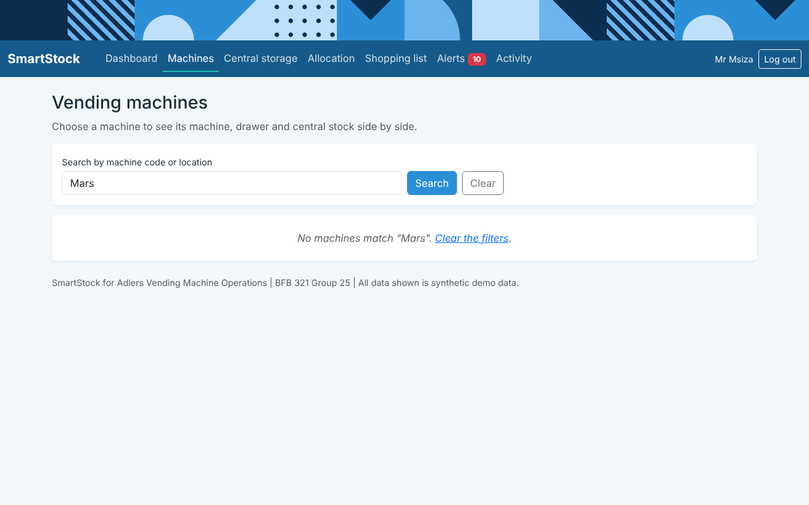
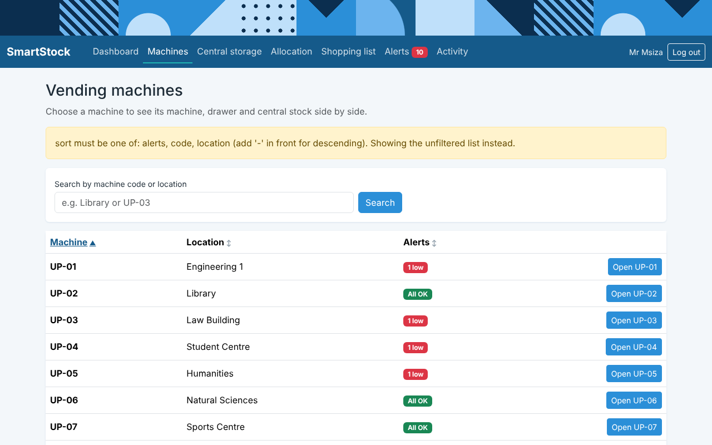
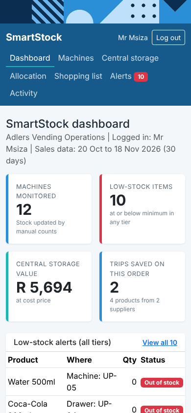
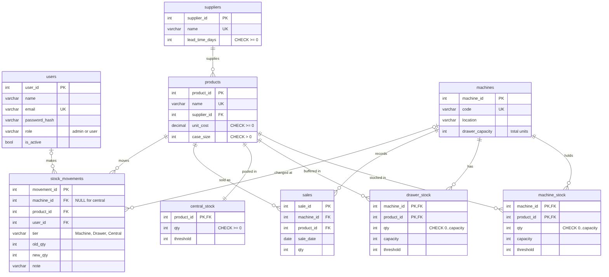

# SmartStock: Adlers Vending Machine Operations

BFB 321, Group 25. Project: **SmartStock**, a three-tier stock dashboard for Adlers Vending Machine Operations.

| Member | Student no. | GitHub username |
|---|---|---|
| Claudia Aird | u21433098 | [u21433098](https://github.com/u21433098) |
| Josua Olivier | u23524431 | [Josua-Olivier](https://github.com/Josua-Olivier) |

SmartStock is a web dashboard that gives Mr Msiza **one system** for the three places his vending stock lives:
the **machine**, the small **drawer** at its base, and the shared **central storage** at the Adlers café.
It also turns what is needed into **one consolidated order per supplier**.
It replaces the paper log and goes beyond what the third-party app Moma tracks.

> **Demo data.** Every machine, product, sale and stock level loaded by `flask seed` is synthetic.
> The Moma sensor feed named in the proposal is not available, so machine stock is entered as a
> manual count (the fallback stated in the proposal).

## Features (mapped to the proposal)

| Feature | Page | Objective |
|---|---|---|
| Machine, drawer and central stock side by side | Machines list, then a detailed machine’s page | O1, O2 |
| Record a manual machine count | Machine page | O1 (fallback) |
| Log a restock visit (takes the units out of central storage, fills the machine, then the drawer, and returns the rest to central) | Machine page | O2 |
| Central storage tracker | Central storage | O2 |
| Drawer allocation ranking from 30-day sales | Allocation | O3 |
| Consolidated shopping list, one order per supplier | Shopping list | O4 |
| Low-stock alerts across all three tiers | Alerts | O3, O5 |
| KPI dashboard (alerts, central value, trips saved, best sellers, impact estimate) | Dashboard | O5 |
| Activity log: every stock change with who, when and why, filterable | Activity | O2 |
| Search, filters, sortable columns and paging on every list (no JavaScript) | Machines, Central storage, Alerts, Activity | O2, O5 |
| Accounts for Mr Msiza and his helpers, managed by the admin (no public sign-up) | Users (admin only), Account | Roles |
| REST API with the same data and actions, plus an OpenAPI contract | `/api/v1/...` ([docs/api.md](docs/api.md)) | All |

## Screenshots and end-to-end flows

Five complete flows (alert to restock, shopping list to stock take, following the drawer recommendation, the admin
adding and removing a helper, and an outside program restocking through the API) are described step by step with
screenshots in [**docs/e2e_flows.md**](docs/e2e_flows.md). They are tested end to end in `tests/test_e2e.py`, and
`scripts/capture_screenshots.py` replays them in a real browser to take the screenshots.

| Dashboard | One machine, all three tiers, after a restock |
|---|---|
|  |  |

| Shopping list, one order per supplier | Machines sorted by alerts, paged | Admin: user accounts |
|---|---|---|
|  |  |  |

| Empty state | Error state (bad value in the address) | Phone |
|---|---|---|
|  |  |  |

## Quick start (Windows PowerShell)

You need Python 3.11+ and a running MySQL 8 (or MariaDB 10.4+, e.g. from XAMPP) server.

**1. Create the database and its user** (once). Open the MySQL client as root
(`mysql -u root -p`, or the SQL tab in phpMyAdmin) and run:

```sql
CREATE DATABASE smartstock CHARACTER SET utf8mb4;
CREATE USER 'smartstock'@'localhost' IDENTIFIED BY 'choose-a-password';
GRANT ALL ON smartstock.* TO 'smartstock'@'localhost';
```

Pick any password (letters and numbers only, because it goes into a web address); you will type the same one
into `.env` in step 2. Each person who runs SmartStock creates their own; no real password is stored in this repository.

**2. Install and configure the app**

```
git clone https://github.com/u21433098/u21433098-group25_smartstock_dashboard.git
cd u21433098-group25_smartstock_dashboard
python -m venv venv
venv\Scripts\activate
pip install -r requirements.txt
copy .env.example .env
```

Open `.env` and put your MySQL password into `DATABASE_URL`, and set your own `SECRET_KEY`.

**3. Build the tables and load the demo data** (one step)

```
flask setup --yes
```

This runs the migrations (`flask db upgrade`) and loads the demo data (`flask seed --yes`) in one go.
To reload only the demo data later, run `python seed.py` (or `flask seed --yes`).

**4. Run it**

```
python app.py
```

Open http://127.0.0.1:5000 in a browser. The page styles load Bootstrap's CSS from a CDN, so an internet connection is needed.

**Demo logins** (both use the password `SmartStock123`):

| Account | Email | Role |
|---|---|---|
| Mr Msiza | `msiza@adlers.test` | user |
| Claudia Aird (developer) | `admin@smartstock.test` | admin |

If activation says "running scripts is disabled", run once:
`Set-ExecutionPolicy -Scope CurrentUser -ExecutionPolicy RemoteSigned`

### Database commands

| Command | What it does |
|---|---|
| `flask setup --yes` | One step from an empty database: builds the tables, then loads the demo data |
| `flask db upgrade` | Creates or updates the tables to the latest migration |
| `flask db downgrade base` | Rollback: removes all SmartStock tables |
| `flask seed --yes` or `python seed.py --yes` | Wipes all rows and loads the demo data (sales end yesterday) |
| `flask create-admin` | Creates an admin account (asks for name, email and password) |
| `flask db migrate -m "message"` | After changing `app/models`, generates a new migration file |

Stock changes are now saved in MySQL, so they survive a server restart. Run `flask seed --yes` to get back to the demo starting point.

## Run the tests

```
pytest
```

By default the tests use a throwaway in-memory SQLite database, so they need no MySQL server.
To run them against MySQL as well, create a **separate** `smartstock_test` database (the tests wipe it),
grant the `smartstock` user access, and set `TEST_DATABASE_URL` in `.env` (see `.env.example`).

- `tests/test_safety_stock.py`, `test_allocation.py`, `test_procurement.py`: unit tests for the supply chain model, checked against hand-calculated answers.
- `tests/test_routes.py`: integration tests for login, access control, CSRF protection, and the stock-changing flows.
- `tests/test_database.py`: database tests proving the keys, CHECK constraints, cascades and indexes are enforced by MySQL itself.
- `tests/test_services.py`: paging, sorting, filtering, error types and role rules of the services layer.
- `tests/test_api.py`: every REST API endpoint: login, CSRF header, validation, JSON errors, paging and roles.
- `tests/test_openapi.py`: the OpenAPI contract matches the code (every route documented, real responses match the schemas).
- `tests/test_pages.py`: search, filters, sorting and paging on the pages, empty and error states, accessibility basics.
- `tests/test_admin.py`: the admin pages and "change my password".
- `tests/test_e2e.py`: the five end-to-end flows in `docs/e2e_flows.md`.
- `tests/conftest.py`: shared fixtures (a fresh demo database per test, logged-in web and API clients).
- `tests/test_ops.py`: log files and their 14-day rotation, the `flask health` check, production settings, `wsgi.py`,
  and backups (old-backup clean-up, the temporary password file, and a real backup-and-restore round trip on MySQL).

## Project structure

```
app/
  __init__.py         create_app(): settings, database, login, CSRF, error pages, flask commands
  extensions.py       the shared database (SQLAlchemy) and migration objects
  models/             MySQL tables as SQLAlchemy classes (keys, checks, indexes)
  blueprints/         one file per feature: auth, dashboard, inventory, allocation, procurement,
                      admin (user accounts) and api (the REST API, /api/v1)
  services/           the only layer that touches the database; calls the supply chain models
                      (errors.py: error types; pagination.py: paging, sorting, input checks)
  data/seed_data.py   synthetic demo data, loaded with `flask seed`
  schemas/            checks for the JSON the REST API receives (types, ranges, unknown fields)
templates/            one HTML file per page (Jinja2) + base.html and _macros.html
static/css/           style.css (on top of Bootstrap CSS; no JavaScript)
models/               supply chain model: pure Python, no Flask, no database
  safety_stock.py     average demand, std deviation, safety stock, reorder point
  allocation.py       turnover ranking, greedy drawer allocation, restock split
  procurement.py      order-up-to level, order quantity, supplier grouping, trips saved, EOQ
migrations/           Flask-Migrate (Alembic) migration scripts; 0001 builds every table
docs/                 erd.md + erd.png (data model), schema.sql (generated SQL),
                      api.md + openapi.json (API), e2e_flows.md + screenshots/, impact/ (report charts)
scripts/              capture_screenshots.py, benchmark.py, impact_report.py (documentation tools)
tests/                pytest unit, database, services, operations, API, contract, page and end-to-end tests
deploy/               production files: start_production.cmd and backup.cmd (Windows),
                      systemd, Gunicorn, Nginx and log-rotation files (Linux server)
app/backup.py         `flask backup` and `flask restore` (Windows and Linux)
config.py             DEV / TEST / PROD settings
app.py                main application file: python app.py starts the app (development)
seed.py               python seed.py loads the demo data (same as flask seed)
wsgi.py               production entry point for Waitress or Gunicorn
app/logging_setup.py  console + daily log files, kept 14 days
```

## Supply chain model

All formulas are in `models/` with docstrings stating assumptions.

| Quantity | Formula |
|---|---|
| Safety stock | `SS = z x s x sqrt(L)` (z = 1.645, a 95% service level) |
| Reorder point | `ROP = d x L + SS` |
| Order-up-to level (weekly review) | `U = d x (L + R) + z x s x sqrt(L + R)` |
| Order quantity | `(U - stock on hand)`, rounded **up** to whole cases |
| Trips saved | `products to order - suppliers to visit` |
| Economic order quantity | `EOQ = sqrt(2DS / H)` |

**Symbols**

| Symbol | Meaning |
|---|---|
| d | average daily demand (units per day) |
| s | standard deviation of daily demand (units per day) |
| z | service-level factor (1.645 for a 95% service level) |
| L | supplier lead time (days) |
| R | review period (days); 7, because Mr Msiza makes a weekly supplier run |
| SS | safety stock (units) |
| ROP | reorder point (units) |
| U | order-up-to level: the stock level each weekly order tops up to (units) |
| D | annual demand (units per year); EOQ only |
| S | cost of placing one order (rand per order); EOQ only |
| H | cost of holding one unit in stock for a year (rand per unit per year); EOQ only |

"Stock on hand" adds the machine, drawer and central tiers together.

**Why the app does not use EOQ.** There are two common ways to decide how much to order.

- **EOQ (economic order quantity)** finds the best size for each order, balancing the cost of ordering often against the cost of storing too much. It assumes you can place an order whenever you like, and it needs figures we do not have: the cost of placing one order and the cost of holding stock for a year.
- **The order-up-to method** works the way Mr Msiza actually buys. He does one supplier run each week. On every run, the app adds up the stock in the machines, drawers and central storage, then orders enough to reach a target level that covers the week ahead, the supplier's lead time and some safety stock. The order is rounded up to whole cases.

SmartStock uses the order-up-to method for the shopping list, because it fits a fixed weekly run and needs no cost data. The `eoq()` function is still in `models/procurement.py` and is unit-tested, but the app does not call it. It is kept as a reference calculation, so the report can explain the alternative that was considered.

**Drawer allocation (O3):** rank products by units sold in the last 30 days; give each its desired buffer
(3 days of sales, capped by its slot size), fastest sellers first, until the drawer's total space (50 units) is used.
Anything that does not fit stays in central storage.

**Impact estimate.** Two 60-minute unplanned supplier trips a week is about 8.7 hours of driving a month.
A 25% cut in trips (O4) therefore saves about **2.2 hours a month**. This is a modelled estimate, not a measurement.


## Roles

| Role | Who | Can |
|---|---|---|
| `admin` | The developer | Everything a user can, plus add accounts, switch accounts on/off, change roles, reset passwords |
| `user` | Mr Msiza and anyone helping him restock | See every page, record counts, log restocks, do stock takes, change own password |

The rules live in one place, `ROLE_PERMISSIONS` in `app/services/user_service.py`. Routes ask
`user_service.can(current_user, "manage_users")`. The account functions also check the role themselves, so a missing check in a
route cannot let a normal user manage accounts. An admin cannot switch off or demote themselves, and there is always at least one active admin.

## Services layer (what the API routes call)

Routes pass the raw query-string text straight in; the services check it. List functions return one page:
`{"items": [...], "page", "per_page", "total", "pages", "has_prev", "has_next"}` (default 20 per page, max 100).
Sorting: `sort=key` ascending or `sort=-key` descending, only from the allowed keys.

| Function | Filters / sort keys |
|---|---|
| `inventory_service.list_machines(search, sort, page, per_page)` | `search` (code or location); sort `code`, `location`, `alerts` |
| `inventory_service.get_machine_detail(machine_id)` | One machine with its three-tier stock rows |
| `inventory_service.list_central(search, supplier_id, low_only, sort, page, per_page)` | sort `name`, `supplier`, `qty`, `value` |
| `inventory_service.list_movements(machine_id, product_id, tier, date_from, date_to, page, per_page)` | Audit trail, newest first, paged in the database |
| `inventory_service.set_machine_count / restock_visit / set_central_count` | Stock changes (one transaction each, audited) |
| `alert_service.list_alerts(tier, severity, machine_id, page, per_page)` | `tier` Machine/Drawer/Central, `severity` out/low |
| `analytics_service.get_allocation(machine_id)` | Drawer recommendation (O3) |
| `analytics_service.build_shopping_list()` | One order per supplier (O4) |
| `analytics_service.get_dashboard_summary()` | KPIs, top alerts, order summary, best sellers, sales window |
| `catalogue_service.create_/update_supplier, create_/update_product, create_/update_machine, add_product_to_machine` | Add and change suppliers, products and machines (both roles; duplicates give 409) |
| `catalogue_service.list_suppliers / get_supplier / list_products / get_product` | `list_products`: `search`, `supplier_id`; sort `name`, `supplier`, `unit_cost`, `central_qty` |
| `user_service.list_users / get_user_detail / admin_create_user / set_role / set_active / reset_password` | Admin only (first argument is the logged-in user) |
| `user_service.change_own_password(user, current, new)` | Any logged-in user |

**Errors** (`app/services/errors.py`): `ValidationError` (400), `PermissionDenied` (403), `NotFoundError` (404) and
`ConflictError` (409). Each has `.status`, `.message`, an optional `.field`, and `.to_dict()`, so one error handler can
answer every API error in the same JSON shape. All of them are `ValueError`s, so existing `except ValueError` code keeps working.

## Design decisions

- **No JavaScript.** Every action is an HTML form submit and every page is a server-rendered Jinja template.
  Bootstrap is used for its CSS only. The navigation bar wraps on small screens instead of using a menu button.
- **One template per page**, with shared pieces (navigation bar, flash messages, KPI cards, stock badges) in `base.html` and `_macros.html`.
- **Passwords are hashed**, forms are protected by a CSRF token, and login redirects only to pages inside this site.
  There is no public sign-up: the admin adds each account.
- **Lists without JavaScript.** Search, filters, sorting and paging are part of the address
  (e.g. `/central?supplier_id=3&sort=-value&page=2`), so views can be bookmarked and the Back button works.
  Column headers are links that tell screen readers the sort order. A bad value in the address shows a warning and
  the unfiltered list instead of an error page.
- **One API, same rules.** The REST API calls the same services as the pages, so validation, roles and the audit
  trail are identical. It uses the login session; changes need the CSRF token in an `X-CSRF-Token` header.
- **Services layer.** Routes never touch the database directly. This paid off in the MySQL move: only `app/services` was rewritten, and no template changed.

## REST API

The API gives other programs (a sensor bridge, a phone app, Postman) the same data and actions as the pages.
Full guide with real examples: [**docs/api.md**](docs/api.md). Machine-readable contract (OpenAPI 3):
[**docs/openapi.json**](docs/openapi.json), also served by the app at `/api/v1/openapi.json`.

| Method | Address (after `/api/v1`) | Who | What |
|---|---|---|---|
| GET | `/auth/csrf` | anyone | CSRF token and session (call first) |
| POST | `/auth/login`, `/auth/logout` | anyone / logged in | Log in, log out |
| GET | `/auth/me` | logged in | Who am I, permissions, CSRF token |
| PUT | `/me/password` | logged in | Change my password |
| GET | `/dashboard` | logged in | KPIs, top alerts, order summary, best sellers |
| GET | `/machines`, `/machines/{id}` | logged in | Machines (search, sort, page); one machine with all three tiers |
| POST, PATCH | `/machines`, `/machines/{id}` | logged in | Add a machine; change its location or drawer capacity |
| POST | `/machines/{id}/products` | logged in | Start carrying a product in a machine |
| PUT | `/machines/{id}/stock/{product_id}` | logged in | Record a machine count |
| POST | `/machines/{id}/restocks` | logged in | Log a restock visit |
| GET | `/machines/{id}/allocation` | logged in | Drawer allocation ranking (O3) |
| GET, PUT | `/central`, `/central/{product_id}` | logged in | Central storage (filter, sort, page); stock take |
| GET | `/alerts`, `/movements` | logged in | Low-stock alerts; the audit trail (filters, paging) |
| GET | `/shopping-list` | logged in | One order per supplier (O4) |
| GET, POST | `/products`, `/suppliers` | logged in | List (filter, sort, page); add |
| GET, PATCH | `/products/{id}`, `/suppliers/{id}` | logged in | One product or supplier; change it |
| GET, POST | `/users` | admin | List accounts; add an account |
| GET | `/users/{id}` | admin | One account |
| PATCH, PUT | `/users/{id}`, `/users/{id}/password` | admin | Role or on/off; reset a password |

Errors always look like `{"error": {"status": 400, "message": "...", "field": "qty"}}`.

## Impact report

The impact report is a Word document, **SmartStock_Impact_Report.docx**, submitted separately (it also states the
Turnitin similarity score). It compares the paper-and-Moma baseline from the proposal with SmartStock running on
the demo data, with charts, sustainability and a measured scalability test (12 to 200 machines). Its charts and
figures are in [`docs/impact/`](docs/impact/), produced by `scripts/impact_report.py` and `scripts/benchmark.py`.
Headlines (modelled on synthetic data; assumptions are listed in the report):

- 3 of 3 stock tiers tracked instead of 1; 111 paper records replaced; one screen per machine instead of three.
- 40% fewer supplier trips for the same order (O4 target: 25%), about 3.5 hours less driving a month.
- 12 low-stock alerts visible instead of 4, and all 4 machine shortages shown with drawer stock that can fix them.
- At 200 machines the slowest page is still built in about 0.13 seconds.

## Data model (MySQL)



Nine tables in third normal form: `users`, `suppliers`, `products`, `machines`, one table per stock tier
(`machine_stock`, `drawer_stock`, `central_stock`), daily `sales` totals, and the `stock_movements` audit trail.
Every table has `created_at` / `updated_at` audit columns, except the `stock_movements` audit trail, which has
`created_at` only because its rows are never edited.

- **Constraints in the database, not only in Python:** CHECK constraints stop stock going negative or above a
  slot's capacity; foreign keys use RESTRICT, CASCADE or SET NULL depending on what should happen on delete.
- **Indexes match how the app reads data:** for example `sales (product_id, sale_date)` for fleet-wide 30-day demand,
  and `machine_stock (product_id, machine_id)` for stock per product across all machines.
- **Every stock change is one transaction:** the stock rows are locked (`SELECT ... FOR UPDATE`) and the audit row
  is saved together with the change, or not at all.
- **The 30-day window ends on the latest recorded sale**, so a demo database seeded a week ago still shows a full month.

Full detail (constraint and index tables, normalisation notes): [`docs/erd.md`](docs/erd.md). Generated SQL: [`docs/schema.sql`](docs/schema.sql).

## Deployment and operations

Three ways to run SmartStock:

| Where | Server | Use it for |
|---|---|---|
| Your PC, `python app.py` | Flask's built-in server | Development only (shows debug pages, one request at a time) |
| One Windows PC at Adlers | Waitress (`deploy\start_production.cmd`) | Realistic for Adlers: one office PC, reached by others on the café network |
| A Linux server | Gunicorn behind Nginx with HTTPS (`deploy/`) | A proper hosted deployment, reachable from a phone anywhere |

### Production settings (`.env`)

Production (`wsgi.py`) always uses the `ProductionConfig` in `config.py`. It **refuses to start** without
`SECRET_KEY` and `DATABASE_URL`, never shows debug pages, and marks the login cookie HttpOnly and SameSite=Lax.
On the Linux set-up with HTTPS, also set `BEHIND_HTTPS_PROXY=1`, so the cookie is only sent over HTTPS
and the real visitor address from Nginx is trusted.

Make a strong key once with: `python -c "import secrets; print(secrets.token_hex(32))"`

### Option A: Windows PC with Waitress

Do the Quick start first (database, `.env`, `flask db upgrade`; production does not need the demo data). Then:

```
flask create-admin                      # real admin account (or flask seed --yes for the demo data)
flask health                            # every line must say [OK]
deploy\start_production.cmd            # or double-click it in File Explorer
```

Open http://127.0.0.1:8000 on that PC, or http://PC-IP-ADDRESS:8000 from another computer on the network
(find the address with `ipconfig`; allow Python through the firewall on *Private networks* when Windows asks).

**Start automatically and back up every night** (run once, in PowerShell opened *as Administrator*,
replacing the path with your project folder; the path must not contain spaces):

```
$P = "C:\dev\u21433098-group25_smartstock_dashboard"
schtasks /Create /TN "SmartStock" /SC ONSTART /RU SYSTEM /TR "$P\deploy\start_production.cmd"
schtasks /Create /TN "SmartStock backup" /SC DAILY /ST 02:00 /RU SYSTEM /TR "$P\deploy\backup.cmd"
```

Both are plain `.cmd` files on purpose. Starting PowerShell with `-ExecutionPolicy Bypass` is flagged as harmful
by antivirus software (malware uses that pattern), and Windows blocks PowerShell scripts for scheduled tasks by default.

Check them in *Task Scheduler*; remove with `schtasks /Delete /TN "SmartStock"` (and `"SmartStock backup"`).

### Option B: Linux server with Gunicorn and Nginx

On Ubuntu, as a user with `sudo`, assuming the project lives in `/opt/smartstock` and runs as user `smartstock`:

```
sudo apt install python3-venv mysql-server nginx certbot python3-certbot-nginx
sudo useradd --system --create-home smartstock
sudo git clone https://github.com/u21433098/u21433098-group25_smartstock_dashboard.git /opt/smartstock
sudo chown -R smartstock:smartstock /opt/smartstock
cd /opt/smartstock
sudo -u smartstock python3 -m venv venv
sudo -u smartstock venv/bin/pip install -r requirements.txt
sudo -u smartstock cp .env.example .env     # then edit: SECRET_KEY, DATABASE_URL, BEHIND_HTTPS_PROXY=1
# create the database and user exactly as in Quick start step 1 (sudo mysql)
sudo -u smartstock venv/bin/flask db upgrade
sudo -u smartstock venv/bin/flask create-admin
sudo -u smartstock venv/bin/flask health
```

Then install the services (each file in `deploy/` starts with the same commands as comments):

```
sudo cp deploy/smartstock.service deploy/smartstock-backup.service deploy/smartstock-backup.timer /etc/systemd/system/
sudo systemctl daemon-reload
sudo systemctl enable --now smartstock smartstock-backup.timer
sudo cp deploy/nginx-smartstock.conf /etc/nginx/sites-available/smartstock     # edit server_name first
sudo ln -s /etc/nginx/sites-available/smartstock /etc/nginx/sites-enabled/
sudo certbot --nginx -d your.domain.example                                    # free HTTPS certificate
sudo cp deploy/logrotate-nginx-smartstock /etc/logrotate.d/smartstock
sudo nginx -t && sudo systemctl reload nginx
```

systemd restarts SmartStock if it crashes and starts it after a reboot. See its output with `journalctl -u smartstock -f`.

### Updating to a new version, and the rollback plan

Every update follows the same five steps, so it can always be undone:

| Step | Windows | Linux |
|---|---|---|
| 1. Back up the data | `flask backup` | `venv/bin/flask backup` |
| 2. Note the current version | `git log --oneline -1` | same |
| 3. Get the new code | stop the app (Ctrl+C), then `git pull` and `pip install -r requirements.txt` | `git pull`, then `venv/bin/pip install -r requirements.txt` |
| 4. Update the tables | `flask db upgrade` | `venv/bin/flask db upgrade` |
| 5. Check and start | `flask health`, then start the app | `venv/bin/flask health`, then `sudo systemctl restart smartstock` |

**If something is wrong after an update (rollback):**

1. Stop the app.
2. Undo the table changes: `flask db downgrade -1` (one migration back; repeat if the update added several).
3. Go back to the old code: `git checkout <version noted in step 2>` and `pip install -r requirements.txt`.
4. If data was damaged, restore the backup from step 1 (below).
5. `flask health`, then start the app. Return to the newest code later with `git checkout main`.

**Changing the tables** (for developers): edit `app/models/`, run `flask db migrate -m "what changed"`,
read the new file in `migrations/versions/` (check its `downgrade()` too), test with `flask db upgrade` and
`flask db downgrade -1` on your own database, run `pytest`, then commit the migration with the model change.

### Backups and restore

| | Windows | Linux |
|---|---|---|
| Back up now | `flask backup` | `venv/bin/flask backup` |
| Saved to | `backups\smartstock_YYYY-MM-DD_HHMMSS.sql.gz` | `backups/smartstock_YYYY-MM-DD_HHMMSS.sql.gz` |
| Automatic | Task Scheduler runs `deploy\backup.cmd` daily at 02:00 (Option A); results in `logs\backup.log` | `smartstock-backup.timer`, daily 02:00 |
| Restore | `flask restore backups\FILE.sql.gz` | `venv/bin/flask restore backups/FILE.sql.gz` |

- One Python implementation (`app/backup.py`) for both systems, tested by `tests/test_ops.py` with a real
  backup-and-restore round trip whenever the tests run on MySQL.
- Backups read the database login from `.env`. The password reaches MySQL's tools through a temporary file that is
  deleted straight away, so it never appears on screen, on the command line, or in a script.
- Backups are compressed (gzip). Backups older than **30 days** are deleted automatically (`--keep-days` changes that).
  The `backups/` folder is in `.gitignore`.
- Restore asks for confirmation, then **replaces all data** with the backup. Stop the app first.
- `mysqldump` and `mysql` are found automatically (in the PATH, or in `C:\Program Files\MySQL\`, MariaDB or XAMPP);
  if not, set `MYSQL_BIN` in `.env` to the folder that contains them.
- Keep a copy of the `backups` folder somewhere else as well (e.g. OneDrive), in case the PC fails.
- Test a restore once a month on a spare database, so you know the backups work.

### Logs and monitoring

| What | Where | Kept |
|---|---|---|
| Everything (logins, stock changes, server start) | `logs/smartstock.log` | 14 days (new file every midnight) |
| Warnings and errors only (failed logins, crashes) | `logs/errors.log` | 14 days |
| Requests and server output (Linux) | `journalctl -u smartstock` | systemd's journal settings |
| Nginx access and error logs (Linux) | `/var/log/nginx/smartstock.*.log` | 14 days (logrotate) |

**Health check:** `flask health` checks that the database is reachable, the tables are at the latest migration,
machine data is present and an active admin exists. It prints `[OK]` or `[FAIL]` per check and exits with code 1
on any failure, so a scheduled task or monitoring tool can raise an alert. Run it after every update and restore.

**What to watch:** new lines in `logs/errors.log` (a burst of failed logins, or errors), and the daily
backup file appearing in `backups/`.

### Troubleshooting

| Symptom | Fix |
|---|---|
| `SECRET_KEY must be set` or `DATABASE_URL must be set` | `.env` is missing that line, or you are not in the project folder |
| `Can't connect to MySQL server` | Start MySQL (Windows: *Services* → MySQL80 → Start; Linux: `sudo systemctl start mysql`) |
| `Access denied for user 'smartstock'` | The password in `DATABASE_URL` does not match the one in Quick start step 1 |
| `flask health` says `[FAIL] Migrations` | `flask db upgrade` |
| Pages error after an update | Follow the rollback plan above |

## Known limitations

- No live sensor feed: machine stock is a manual count, and sales come from the demo seed (in production they would
  come from the machines' sales feed).
- On Windows, SmartStock is served over plain http inside the local network. HTTPS needs the Linux set-up
  (Nginx with a free certificate), described under Deployment.
- No limit on login attempts yet: failed logins are logged (`Failed login for ...`), but repeated guessing is not
  slowed down. Adding a short lock-out after several failures would be the next security step.

## Task allocation

| Member | Student no. | Files owned | Reviewed by |
|---|---|---|---|
| Claudia Aird | u21433098 | Supply chain model (`models/`) and its unit tests (`tests/test_safety_stock.py`, `test_allocation.py`, `test_procurement.py`), demo data (`app/data/seed_data.py`, `seed.py`), services layer (`app/services/`), MySQL data model (`app/models/`, `app/extensions.py`, `migrations/`, `docs/erd.md`, `docs/erd.png`, `docs/schema.sql`) and its tests (`tests/test_database.py`), services for the REST API (paging, filtering, sorting, error types, roles and account management, the catalogue: `catalogue_service.py`) and their tests (`tests/test_services.py`), deployment and operations (`wsgi.py`, `app/logging_setup.py`, `app/backup.py`, `deploy/`, `flask health`, `flask backup`, `flask restore`) and their tests (`tests/test_ops.py`), `config.py`, `app.py`, `.env.example`, `.gitignore`, `.gitattributes`, `README.md` with the runbook | Josua Olivier |
| Josua Olivier | u23524431 | Frontend: page templates (`templates/`) and stylesheet (`static/css/style.css`); routes (`app/blueprints/`) including the REST API (`api.py`), admin pages (`admin.py`) and list helpers (`_listing.py`); API request checks (`app/schemas/`); app factory (`app/__init__.py`); tests for routes, API, contract, pages, admin and end-to-end flows (`tests/test_routes.py`, `test_api.py`, `test_openapi.py`, `test_pages.py`, `test_admin.py`, `test_e2e.py`, `conftest.py`); API contract (`docs/openapi.json`, `docs/api.md`), end-to-end flows and screenshots (`docs/e2e_flows.md`, `docs/screenshots/`, `scripts/capture_screenshots.py`), impact and sustainability figures (`docs/impact/`, `scripts/impact_report.py`, `scripts/benchmark.py`) for the Word report, README sections: screenshots, REST API | Claudia Aird |
