# End-to-end flows

These are the jobs SmartStock was built for (proposal sections 3 and 4), followed from start to finish.
Each flow is checked two ways:

- **Automated:** `tests/test_e2e.py` runs every flow through the real pages and fails if any step breaks
  (flows 1 to 5, on both SQLite and MySQL).
- **In a real browser:** `scripts/capture_screenshots.py` clicks through flows 1, 2 and 4 in Chromium and took the
  screenshots below. It stops with an error if a page or a step does not behave as expected.

All data is the synthetic demo data from `flask seed`.

---

## Flow 1: low-stock alert, then restock visit, then alert cleared

**Objectives:** O2 (one combined view per machine), O3 (drawer follows the allocation), feature 6 (alerts in all tiers).
**Who:** Mr Msiza (role `user`).

| Step | What he does | What SmartStock shows |
|---|---|---|
| 1 | Logs in | The dashboard shows 12 low-stock items, including Coca-Cola at UP-01 (4 left, threshold 5) |
| 2 | Opens **Alerts**, filters to machine UP-01 | The machine slot at 4, plus a low drawer slot |
| 3 | Opens **UP-01** | Machine, drawer and central stock side by side for all 8 products |
| 4 | Takes 30 cans of Coca-Cola out of central storage and logs the visit | "Restock saved: 30 taken from central storage; 16 into the machine, 6 into the drawer, 8 returned to central storage." Machine now 20 / 20, central storage 60 to 38 |
| 5 | Back to the alert list | The UP-01 Coca-Cola alert is gone; UP-01 drops from 2 alerts to 1 |
| 6 | Opens **Activity**, filtered to UP-01 | Three audit rows (machine 4 to 20, drawer 6 to 12, central 60 to 38 "Restock visit: 30 taken, 8 returned"), each "by Mr Msiza" |

This is how Mr Msiza works (proposal section 1): he takes a bulk box out of central storage, fills the machine first,
then tops the drawer up to the allocation page's recommendation (never past the drawer's capacity), and takes the rest
back to central storage. The split follows `models/allocation.py`. Central storage therefore only goes down by what was
used (60 - 16 - 6 = 38): no stock appears or disappears. A visit can never take more than central storage holds; the
form then says so and nothing changes.

| Dashboard | Alerts for UP-01 |
|---|---|
| 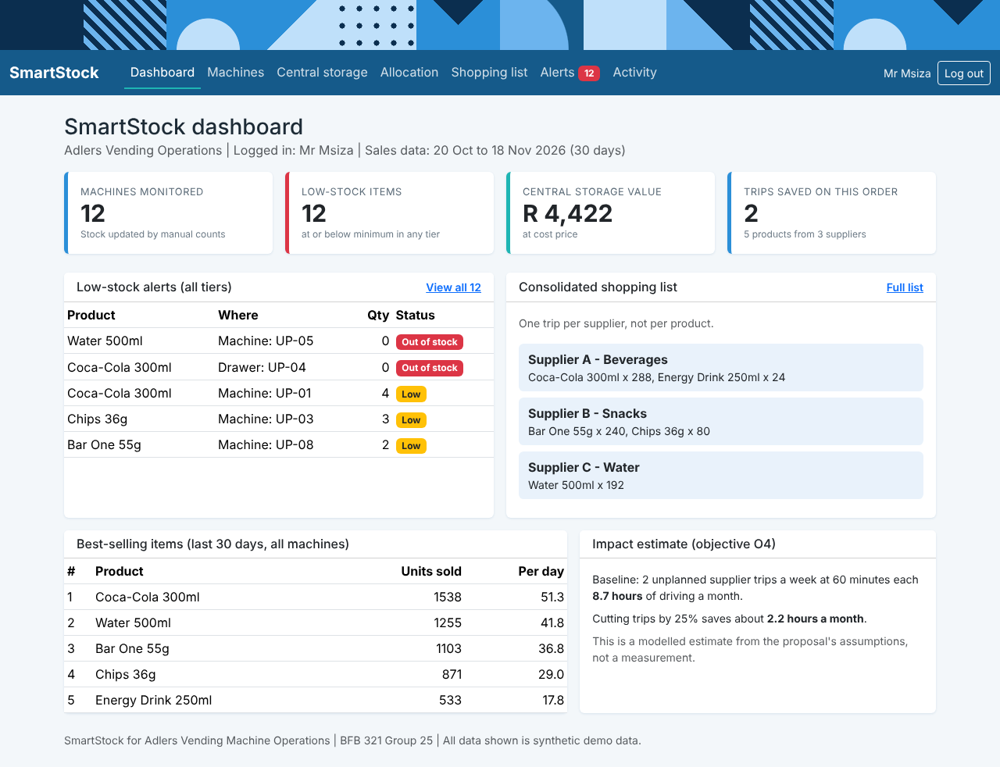 | 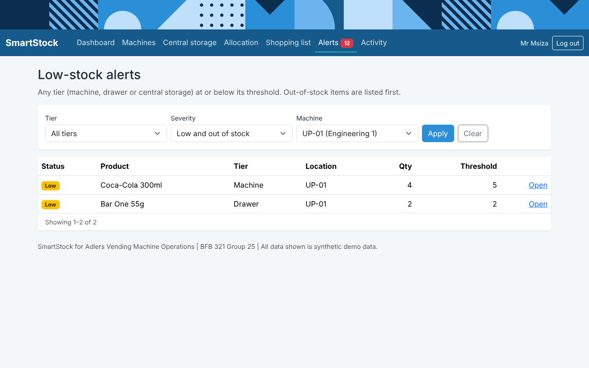 |

| UP-01 before | After saving the restock | Activity log |
|---|---|---|
| 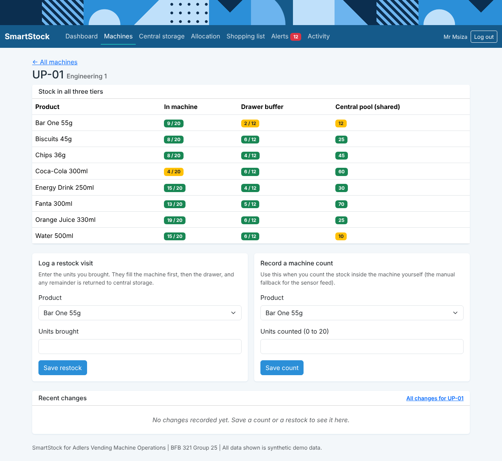 | 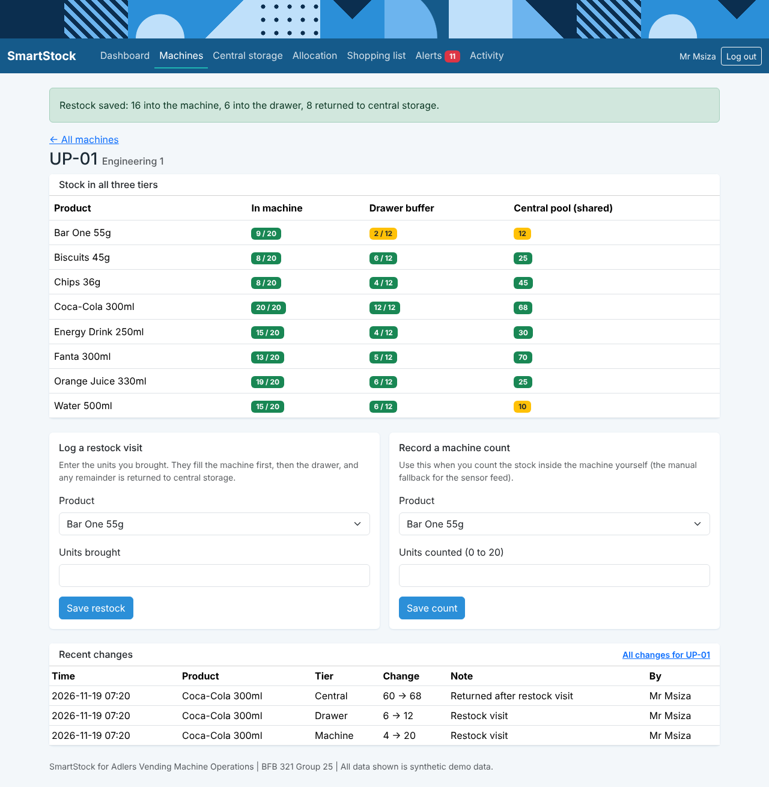 | 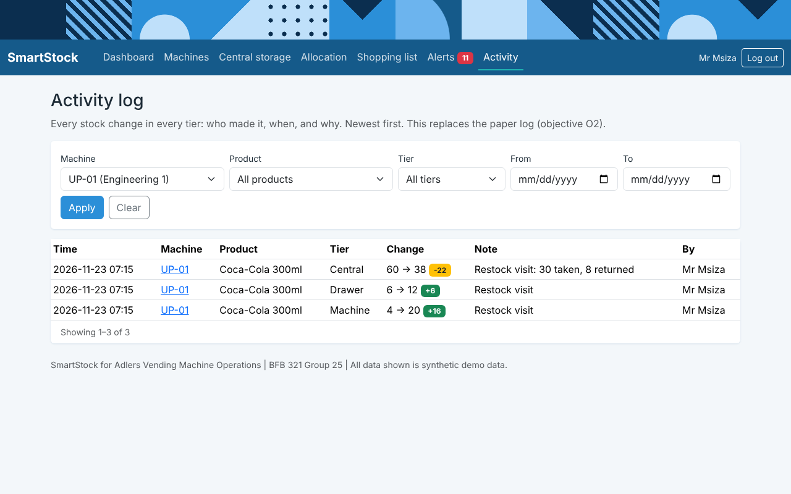 |

---

## Flow 2: shopping list, supplier run, stock take, shorter list

**Objective:** O4 (one prioritised order per supplier, fewer trips).
**Who:** Mr Msiza.

| Step | What he does | What SmartStock shows |
|---|---|---|
| 1 | Opens **Shopping list** | One order per supplier (A: beverages, B: snacks, C: water), built from all three tiers and 30-day demand |
| 2 | Opens **Central storage**, filters to Supplier C and "Low stock only" | Water 500ml at 10 (threshold 20) |
| 3 | After the supplier run, records the delivery: Water 500ml = 250 | "Central storage count saved." Water is no longer low, so it leaves the filtered list |
| 4 | Back to **Shopping list** | Water is gone and **the Supplier C trip is no longer needed** (3 orders become 2) |
| 5 | **Alerts**, tier Central | The central water alert is cleared |

| Shopping list before | Central storage: Supplier C, low only | Shopping list after |
|---|---|---|
| 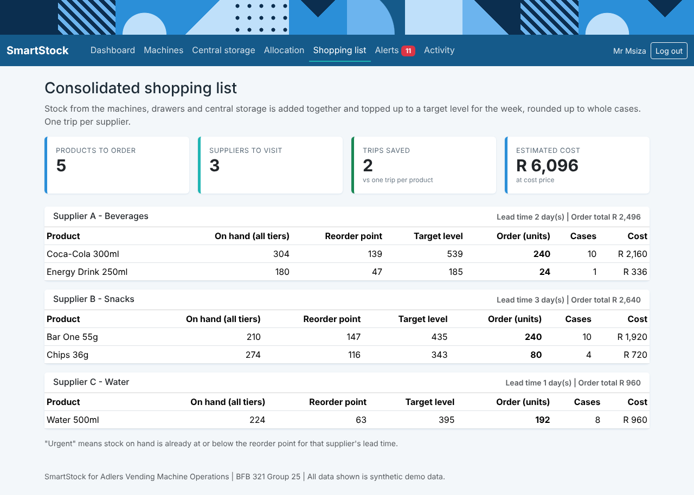 | 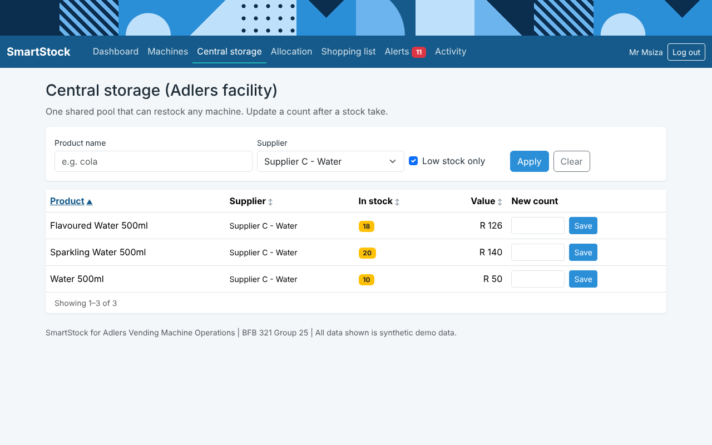 | 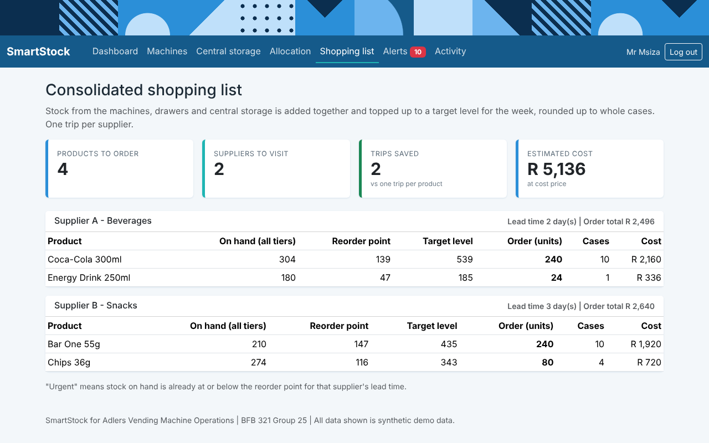 |

---

## Flow 3: follow the drawer recommendation

**Objective:** O3 (a data-driven, repeatable drawer allocation from 30-day turnover).
**Who:** Mr Msiza.

| Step | What he does | What SmartStock shows |
|---|---|---|
| 1 | Opens **Allocation**, machine UP-04 | Products ranked by 30-day turnover. Water 500ml: "Top up by 8" |
| 2 | Central storage only holds 10 bottles, so he records this week's delivery: Water 500ml = 250 | "Central storage count saved." |
| 3 | Logs a restock at UP-04: 40 bottles taken from central storage | The machine is filled first, then the drawer up to the recommendation; the rest goes back |
| 4 | Back to **Allocation** for UP-04 | Water 500ml: "No change" (the recommendation is met) |

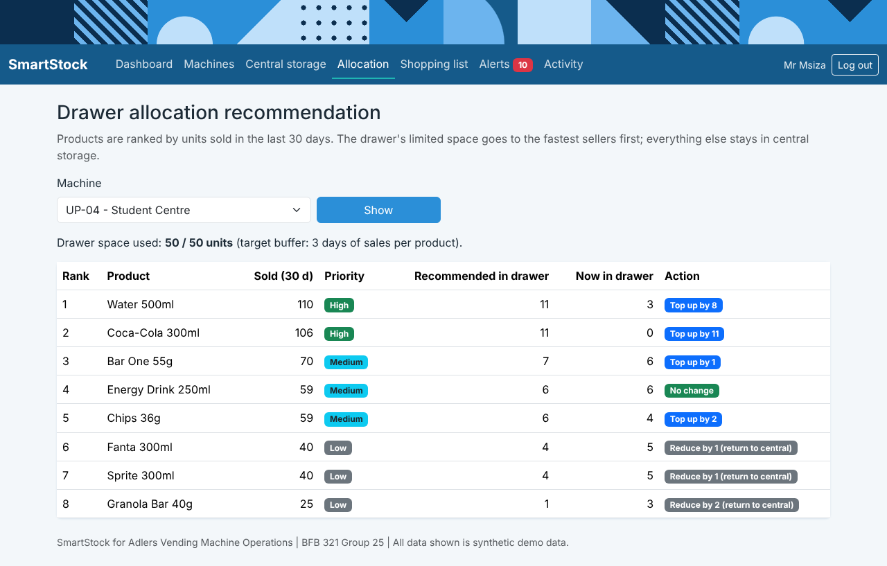

---

## Flow 4: the admin adds a helper, then switches them off

**Requirement:** roles (admin and user), and no public registration.
**Who:** the developer (role `admin`) and a helper (role `user`).

| Step | What happens | What SmartStock shows |
|---|---|---|
| 1 | The admin opens **Users** and adds "Thabo Helper" (role user) | "Account created for Thabo Helper." |
| 2 | Thabo logs in | No **Users** link in his navigation; `/admin/users` gives "Error 403: Only an admin can open that page." |
| 3 | Thabo records a count at UP-02 | The change appears in **Activity** as "Manual count ... Thabo Helper" |
| 4 | Thabo stops helping, so the admin clicks **Switch off** | Thabo is logged out on his next click and can no longer log in |
| 5 | The admin checks **Activity** | Thabo's change is still there: switching an account off never deletes history |

| Admin: user accounts | A user trying the admin page |
|---|---|
| 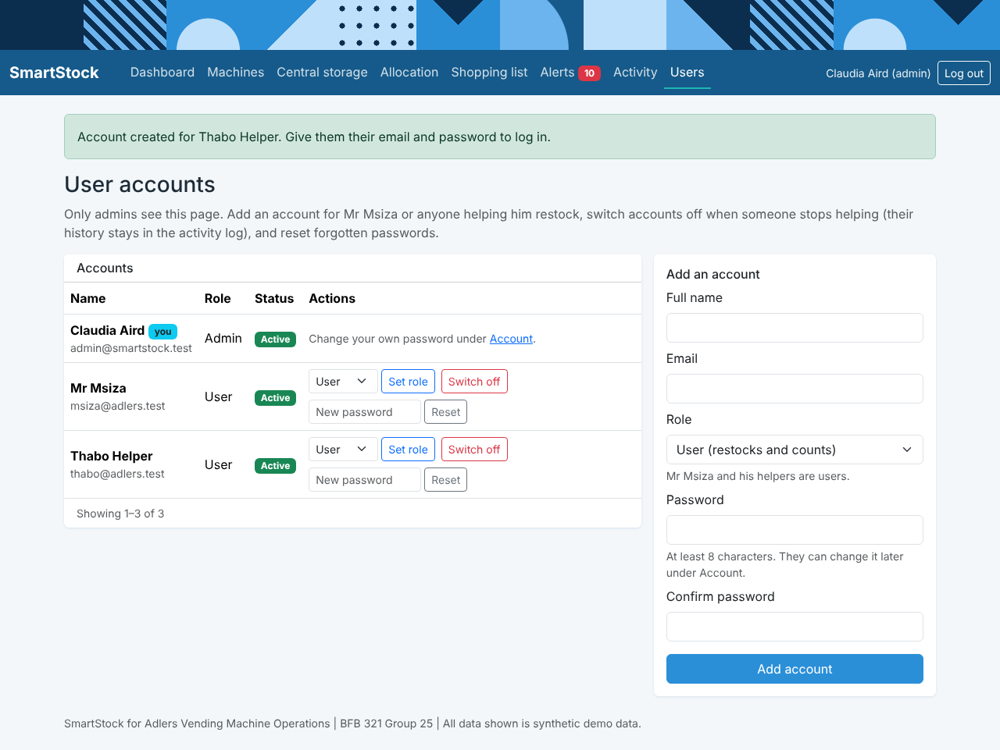 | 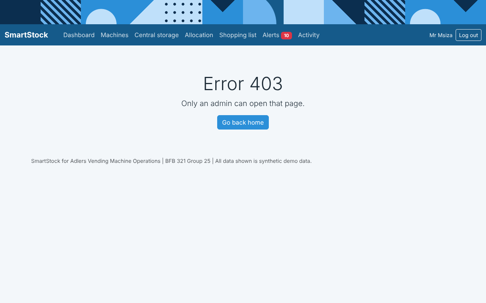 |

---

## Flow 5: an outside program restocks through the API

**Requirement:** the REST API (guide step 4). This is how a future sensor bridge, phone app or script would use SmartStock.

1. The program logs in (`GET /api/v1/auth/csrf`, then `POST /api/v1/auth/login`).
2. It asks for the most urgent machine alert: `GET /api/v1/alerts?tier=Machine&severity=out` returns Water at UP-05, qty 0.
3. Central storage only holds 10 bottles, so it first records the supplier delivery: `PUT /api/v1/central/13` with
   `{"qty": 250}`. (Asking for 24 bottles before that gives a `400`: central storage only holds 10.)
4. It logs the restock: `POST /api/v1/machines/5/restocks` with `{"product_id": 13, "units": 24}`.
5. The alert is gone (`GET /api/v1/alerts?machine_id=5`), the audit trail has the change (`GET /api/v1/movements`), and
   **the same change shows on the web Activity page**, because both use the same services and database.

Requests and responses: see [`api.md`](api.md).

---

## Screen states: empty, loading and error

SmartStock uses **no JavaScript** (a project decision), so every page is built on the server and every state is a real page.

| State | How it is handled | Example |
|---|---|---|
| **Empty, nothing yet** | Each list says what is missing and how to fill it, e.g. "No stock changes recorded yet. Save a count, a restock or a stock take to see it here." | Empty database before `flask seed` |
| **Empty, no matches** | Says what did not match and offers **Clear the filters** | 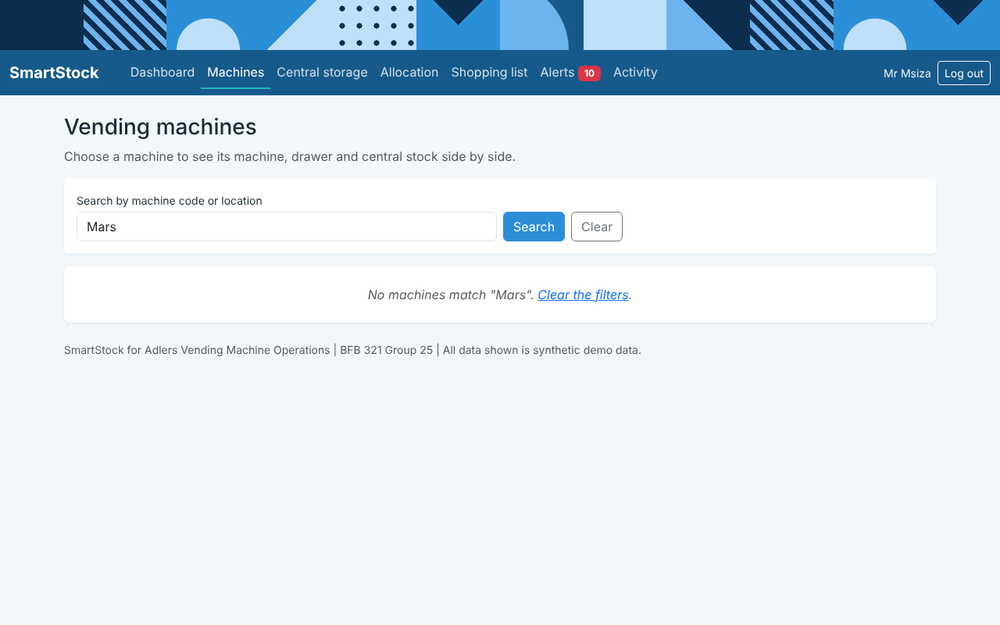 |
| **Error, bad value in the address** | A warning explains what was wrong and the page shows the unfiltered list, instead of crashing | 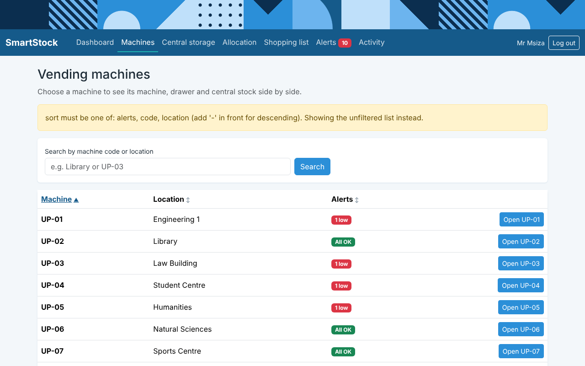 |
| **Error, form input** | The form comes back with a red message and what was typed is kept (e.g. adding an account with a duplicate email) | Admin "Add an account" |
| **Error, not allowed / not found** | Friendly 403 and 404 pages with a "Go back home" button; the API answers in JSON instead | 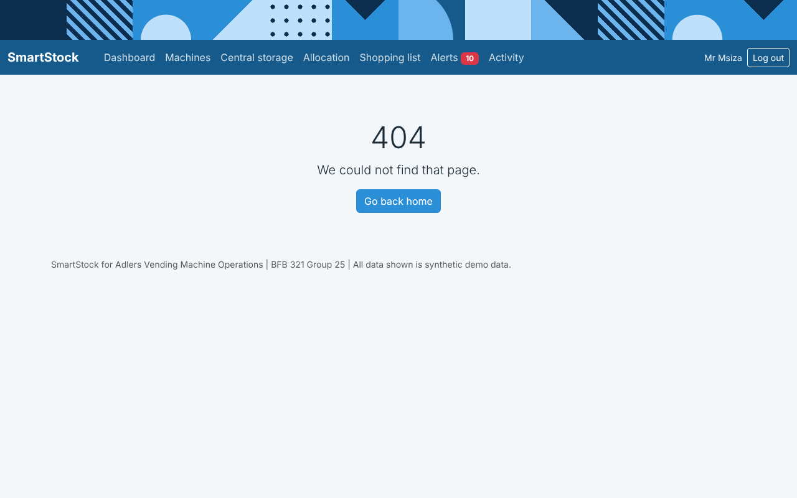 |
| **Success** | A green message says exactly what changed, e.g. how a restock was split | Flow 1, step 4 |
| **Loading** | With no JavaScript there is no partial page: the browser shows its normal loading indicator, and the page arrives complete. Measured server times are in the impact report (scalability section, submitted separately as a Word document); with 12 machines most pages are built in tens of milliseconds | n/a |

Messages are announced to screen readers: errors and warnings use `role="alert"`, success messages `role="status"`.

## Sorting, filtering and paging (no JavaScript)

Every filter, sort and page number lives in the address, e.g. `/central?supplier_id=3&low_only=1&sort=-value&page=2`.
So a filtered view can be bookmarked or shared, the browser's Back button works, and sorting keeps the current filters.
Column headers are links. The active one shows an arrow and tells screen readers the order (`aria-sort`).

| Machines sorted by alerts (page 1 of 2) | Central storage sorted by value |
|---|---|
| 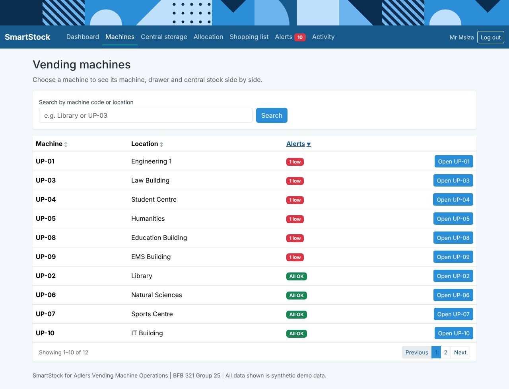 | 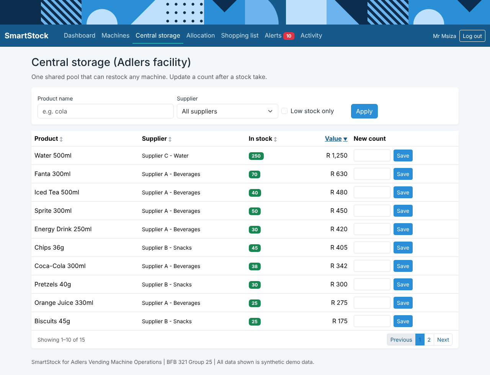 |

## On a phone

The navigation wraps under the logo instead of needing a menu button (which would need JavaScript), and wide tables scroll sideways.

| Dashboard | Machine UP-01 |
|---|---|
| 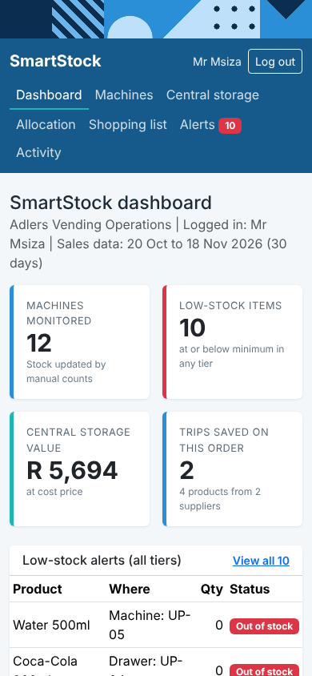 | 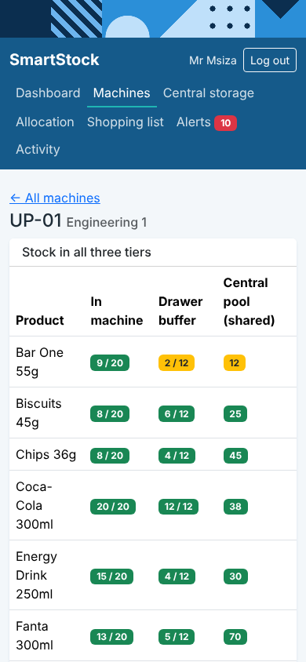 |
