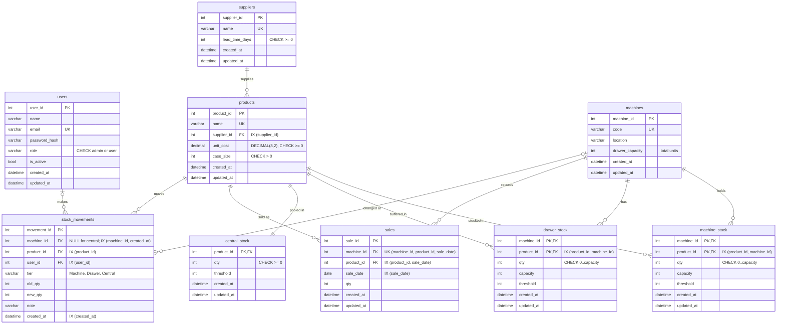

# SmartStock entity relationship diagram

Image version: `docs/erd.png`. Full SQL: `docs/schema.sql`. Source of truth: `app/models/__init__.py`
and the migration in `migrations/versions/0001_initial_schema.py`.

Every table has `created_at` and `updated_at` audit columns, shown in the diagram. `stock_movements` has
`created_at` only, because audit rows are never edited. **Key:** PK primary key, FK foreign key, UK unique;
"IX ..." in the note column names an index that starts with that column (full list under *Indexes* below).

## Keys and constraints

| Table | Rule | Why |
|---|---|---|
| `machine_stock`, `drawer_stock` | Primary key `(machine_id, product_id)` | One slot per product per machine |
| `machine_stock`, `drawer_stock` | `CHECK (qty >= 0 AND qty <= capacity)` | A slot can never be negative or overfilled |
| `sales` | Unique `(machine_id, product_id, sale_date)` | One daily total per product per machine |
| `products.supplier_id` | `ON DELETE RESTRICT` | A supplier cannot be deleted while it still supplies products |
| stock and sales `machine_id` | `ON DELETE CASCADE` | Removing a machine removes its slots and history |
| `stock_movements.user_id` | `ON DELETE SET NULL` | Deleting a user keeps the audit trail |
| `users.role` | `CHECK (role IN ('admin','user'))` | Only the two roles exist |

## Indexes (chosen for how the app reads data)

| Index | Used by |
|---|---|
| `machine_stock (product_id, machine_id)`, `drawer_stock (product_id, machine_id)` | Fleet-wide stock per product (shopping list, alerts) |
| `sales (machine_id, product_id, sale_date)` (unique key) | One machine's 30-day history (allocation) |
| `sales (product_id, sale_date)` | Fleet-wide 30-day demand per product (shopping list, best sellers) |
| `sales (sale_date)` | Finding the latest sales date (the end of the 30-day window) |
| `stock_movements (machine_id, created_at)` | "Recent changes" on a machine page, newest first |
| `stock_movements (created_at)`, `(user_id)`, `(product_id)` | Fleet-wide audit trail; changes by one user; the product foreign key |
| `products (supplier_id)` | Grouping the shopping list by supplier |

## Normalisation (3NF)

- Each fact is stored once: a supplier's lead time is only in `suppliers`, a product's cost and case size
  only in `products`, and the central pool only in `central_stock`.
- The three stock tiers are separate tables because they have different keys: machine and drawer stock
  belong to a `(machine, product)` pair, while central stock belongs to a product alone.
- Totals such as "stock on hand" and "30-day turnover" are calculated by queries, never stored, so they
  cannot go out of date.
